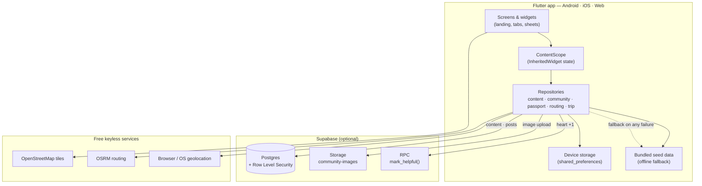
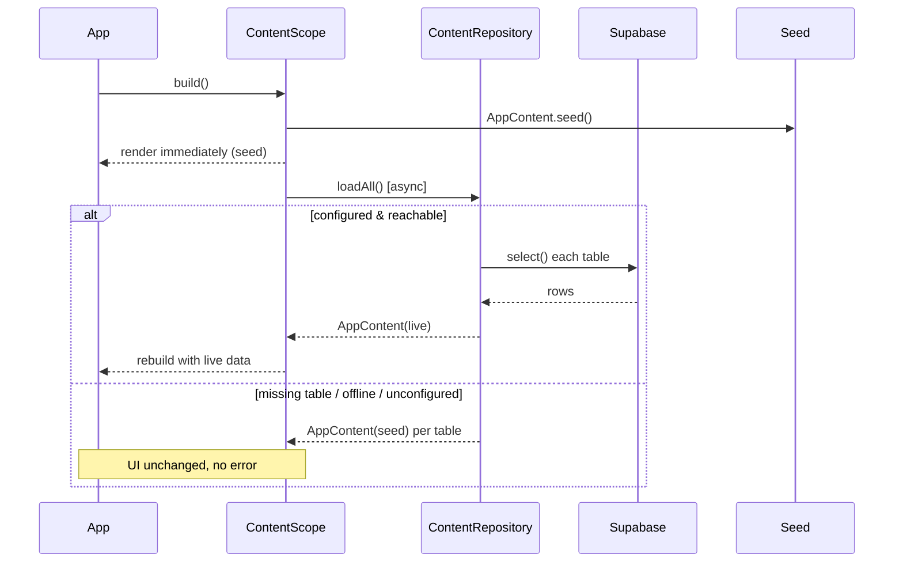
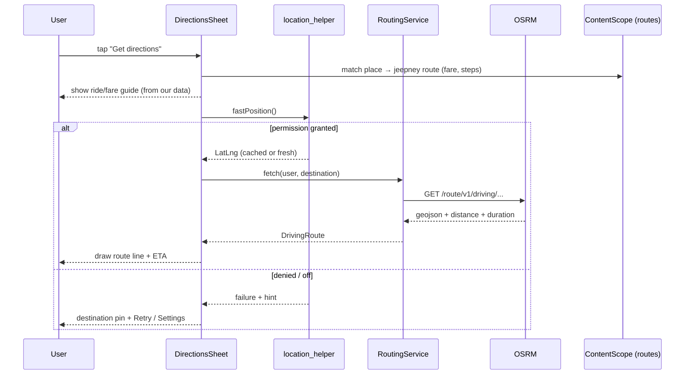
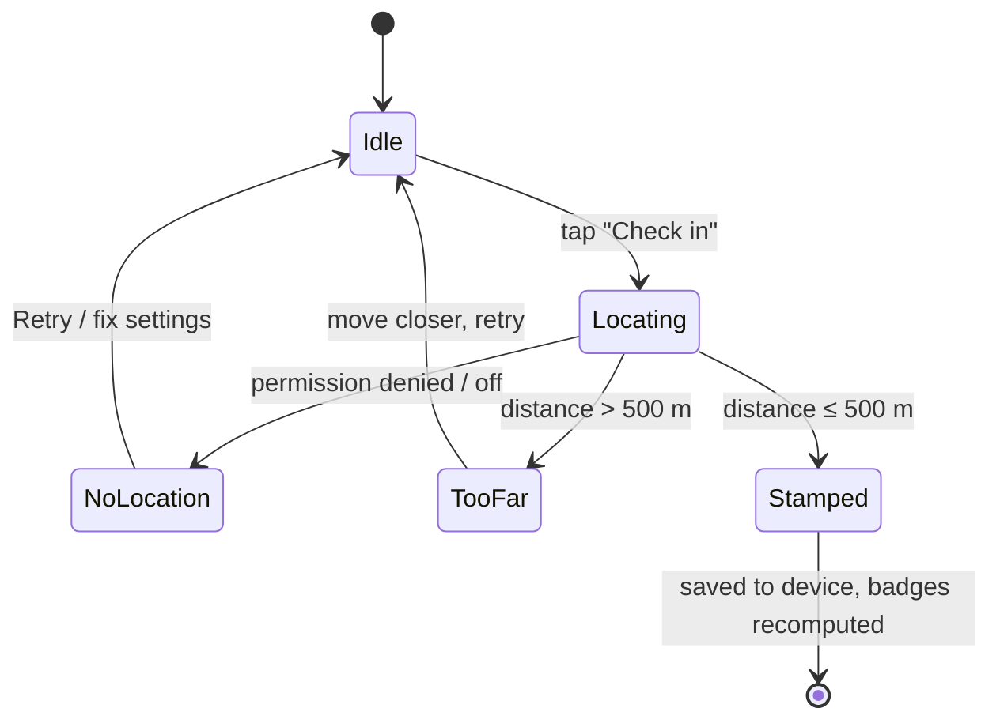
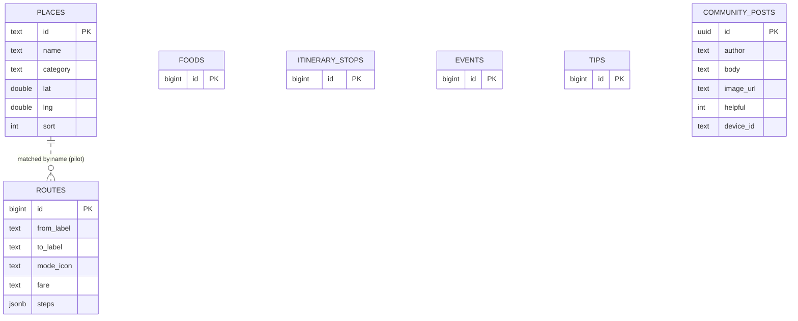
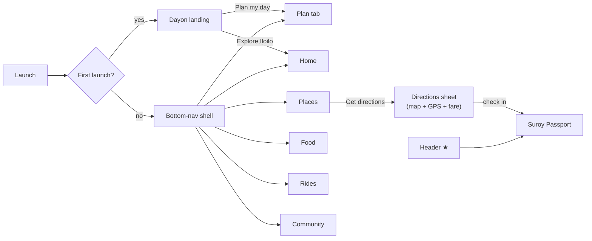

# SuroyIloilo — Architecture

This document explains how the app is built and why. Diagrams are written in
Mermaid, which GitHub renders inline.

## 1. Principles

1. **Offline-first.** The app always renders instantly from bundled seed data,
   then upgrades to live Supabase content when the network allows. A missing
   table, a bad connection, or an unconfigured backend can never break the UI.
2. **Backend-optional.** With no credentials the app is fully functional on
   seed data. Supabase "lights up" when `.env.local` is present.
3. **No accounts.** All personal state (passport stamps, trip plan, nickname,
   hearts) is anonymous and stored on-device. An anonymous device id enables
   moderation without login.
4. **Free & keyless services.** Maps (OpenStreetMap), routing (OSRM) and
   geolocation (browser/OS) need no API keys.

## 2. System architecture



**Rule of thumb:** every dependency degrades gracefully. Remove the backend and
the app runs on seed; deny location and the map shows the destination pin;
drop the network and the route line is skipped but the fare guide remains.

## 3. Module layout

```
lib/
  main.dart              App entry, first-launch routing, bottom-nav shell
  config/env.dart        Loads .env.local (best effort)
  models.dart            Domain models + fromJson + string→glyph mappers
  data/
    content_repository   Fetch content from Supabase, seed fallback per table
    content_scope        InheritedWidget provider (seed now, live on arrival)
    community_repository Anonymous posts, image upload, hearts
    passport_repository  GPS check-ins, badges, fare-saved counter
    routing_service      OSRM road route (pure, testable)
    location_helper      Permission-safe, cached position lookup
    trip_planner         Nearest-neighbor day plan (pure)
    seed_data            Bundled offline content
  screens/               One file per tab + landing + passport
  widgets/               Directions sheet, route map, share sheets, plate
  theme.dart             Design tokens + shared UI atoms (SoftCard, Pill…)
```

## 4. Content load — offline-first sequence



## 5. "Get directions" — API / data flow



The jeepney guidance comes entirely from **our** data; OSRM only draws the
physical road line. That split is the product's edge — no maps API has Iloilo
jeepney fares.

## 6. Passport check-in — state machine



## 7. Data model (Supabase)



Content tables are **public-read, admin-write** (edited in the Supabase Table
editor). `community_posts` is **public-read + length-limited insert**; hearts
move only through the `mark_helpful` RPC. See [SECURITY.md](SECURITY.md).

## 8. Navigation flow



## 9. Known pilot simplifications

- **Route matching** is by place-name substring — fine for 8 places, to be
  replaced by corridor geometry + graph search (no AI needed).
- **Coordinates** are approximate pins; verify in the field before launch.
- **Auth** is intentionally absent — see the roadmap in [PROJECT.md](../PROJECT.md).
