# SuroyIloilo — Plan, Feasibility and Pilot

**Version 1.0 · October 2026 · Owner: Kenan Ben · Status: pre-validation**

This is the working plan for taking SuroyIloilo from a deployed prototype to a
validated, launchable product. It covers what is built, whether the idea is
feasible, how the pilot will test it, what has to be true before each release,
and the data the app depends on. Diagrams are Mermaid and render on GitHub.

Related documents: [ARCHITECTURE.md](ARCHITECTURE.md) (how the app is built),
[SECURITY.md](SECURITY.md) (security and privacy), [TESTING.md](TESTING.md)
(automated tests), [PROJECT.md](../PROJECT.md) (product brief).

## Contents

1. [Summary](#1-summary)
2. [Current state: built vs proven](#2-current-state-built-vs-proven)
3. [Hypotheses to test](#3-hypotheses-to-test)
4. [Feasibility study](#4-feasibility-study)
5. [Pilot testing plan](#5-pilot-testing-plan)
6. [Deployment readiness](#6-deployment-readiness)
7. [Data plan](#7-data-plan)
8. [Metrics and KPIs](#8-metrics-and-kpis)
9. [Risk register](#9-risk-register)
10. [Roadmap and milestones](#10-roadmap-and-milestones)
11. [Immediate next actions](#11-immediate-next-actions)
12. [Appendices](#appendix-a--test-instruments)

---

## 1. Summary

SuroyIloilo is an offline-first travel companion for Iloilo City. Its edge is
the layer map apps do not have: which jeepney to ride, where to transfer, and
the honest fare. The app is built, tested and live on the web. **Nobody outside
the team has used it yet**, so the open question is no longer "can we build
it" but "will people use it, and will anyone pay."

| Question | Short answer |
|---|---|
| Is it technically feasible? | Yes. Built, deployed, 32 automated tests passing, CI in place. |
| Is there an audience? | Plausibly. Iloilo City logged about 1.0 million tourist arrivals in 2024 (up 12.95% from 886,283 in 2023). Unvalidated how many need jeepney help. |
| What does it cost to run? | About ₱23,650 in year-one cash, mostly optional. Monthly running cost about ₱2,000. |
| When does it break even? | On cash costs, at about 9 tour bookings a month. The real cost is time spent keeping fare and route data correct. |
| What is the biggest risk? | Low adoption, then stale data. Fares already changed on Sept 28, 2026, and the app still shows the old ₱13. |
| What do we do next? | A three-phase pilot from October 2026 to February 2027, with the open pilot timed for Dinagyang on January 24, 2027. |

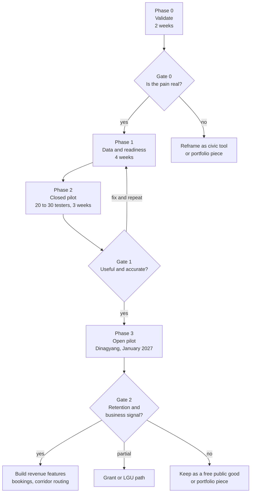

---

## 2. Current state: built vs proven

| Area | Built | Proven with real users |
|---|---|---|
| Six sections: Home, Places, Food, Rides, Plan, Community | Yes | No |
| Live content from Supabase, offline seed fallback | Yes | No |
| Live map, GPS location, road route and ETA | Yes | No |
| Jeepney signboard plates and fare guide | Yes | No — fares not field-verified |
| Trip planner (optimized day, total fare) | Yes | No |
| Suroy Passport (GPS check-in, badges, fare-saved) | Yes | No |
| Community posts with photos | Yes, needs `community.sql` run | No |
| Automated tests and CI | 32 tests, analyze/test/build on every PR | Yes |
| Web deployment | `suroy-iloilo.vercel.app` | Yes |
| Android release | No | No |
| Analytics | No | No |

**Known data issue.** While preparing this plan we found that the LTFRB fare
adjustment approved in March 2026 was suspended, then reinstated on
September 28, 2026. The traditional jeepney minimum fare is now **₱14** (was
₱13) and the modern jeepney minimum is **₱17** (was ₱15). Every fare in the app
still reflects the old matrix. This has to be fixed before any tester sees it,
and it is the clearest example of why data upkeep is the main operating cost.

---

## 3. Hypotheses to test

Each hypothesis has a pass threshold set **before** the test so the result
cannot be argued into a win afterwards.

| # | Hypothesis | Test | Pass threshold |
|---|---|---|---|
| H1 | Visitors struggle to know which jeep to take and what to pay | 5–10 traveler interviews | At least half describe confusion or overpaying without being prompted |
| H2 | Our jeepney guide is correct and helps | Field audit and closed pilot | At least 90% of audited routes correct; at least 70% of testers rate it helpful |
| H3 | People come back | Closed and open pilot analytics | At least 20% return within 7 days |
| H4 | Tour operators would pay for bookings | 2–3 operator interviews | At least 2 of 3 agree in principle to a commission or paid listing |
| H5 | The city would help distribute it | Tourism office meeting | One follow-up meeting or written interest |

H1 is the gate everything else depends on. If H1 fails, nothing below matters.

---

## 4. Feasibility study

### 4.1 Scorecard

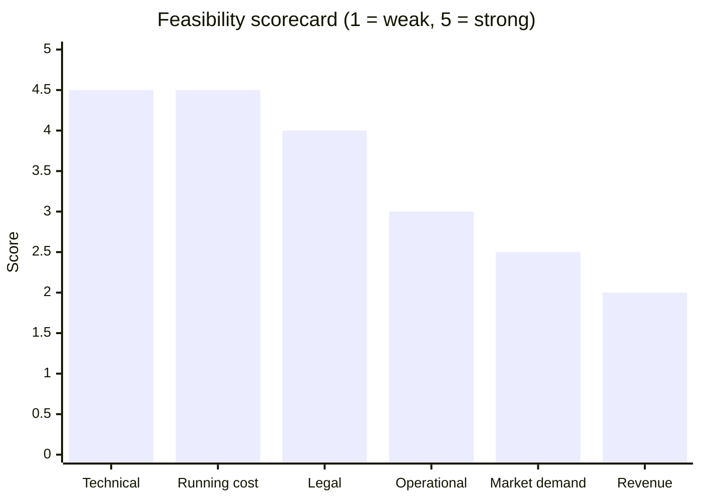

| Dimension | Score | Why |
|---|---|---|
| Technical | 4.5 | Working product, tested, deployed. Gaps are known and small (analytics, Android release, production routing). |
| Running cost | 4.5 | Every service is free or nearly free. No billing card is required to operate. |
| Legal | 4 | Minimal personal data. Needs a privacy notice, terms and business registration before earning. |
| Operational | 3 | Fares and routes change and must be re-verified by hand. This is ongoing work. |
| Market demand | 2.5 | A real gap exists, but no user has confirmed they would use the app. |
| Revenue | 2 | A credible model (tour commissions) exists, but no operator has agreed to it. |

The product is feasible to build and cheap to run. **Demand and revenue are
the unproven parts**, which is exactly what the pilot is designed to test.

### 4.2 Technical feasibility

What is done is described in [ARCHITECTURE.md](ARCHITECTURE.md). The remaining
technical risks before a public launch:

| Gap | Why it matters | Fix | When |
|---|---|---|---|
| No analytics | The pilot cannot be measured without it | Insert-only `events` table in Supabase (free, no new vendor) | Before closed pilot |
| Android platform folders are generated and git-ignored | Location permissions, app ID and signing are lost on every regeneration | Commit `android/` with permissions, icon and app ID | Before closed pilot |
| OSRM public demo server | Rate-limited, not meant for production | Self-host OSRM on a small server, or use a paid router | Before public launch |
| OpenStreetMap standard tiles | The OSM tile policy forbids heavy use of its own servers | Use a tile provider or self-host before scale | Before public launch |
| Route matching by place name | Only works for fixed origin and destination pairs | Corridor model with graph search | After Gate 2 |

### 4.3 Market feasibility

**Context numbers**

| Figure | Value | Source |
|---|---|---|
| Iloilo City tourist arrivals, 2024 | About 1.0 million (up 12.95% from 886,283 in 2023) | DOT figures as reported in the news; confirm with the City Tourism Office |
| Dinagyang Festival attendance, January 25, 2026 | More than 120,000 | Daily Tribune |
| Western Visayas regional arrivals target | 5.6 million | The Manila Times |
| Iloilo City population | 457,626 | PSA 2020 Census |

**Sizing the reachable audience.** The percentages below are assumptions, not
data. Interviews in Phase 0 exist partly to replace them with real numbers.

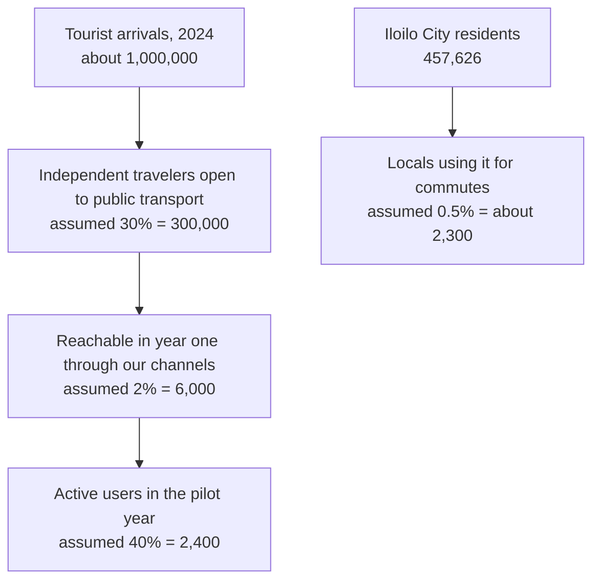

**Competition**

| Alternative | Strength | Gap we fill |
|---|---|---|
| Google Maps | Streets, places, driving and walking directions | No Iloilo jeepney routes or fares |
| Grab | Door-to-door rides and payments | No jeepneys; costs several times a jeep fare |
| Facebook travel groups | Real local advice | Unstructured, unsearchable, often outdated |
| Metro Manila transit apps | Jeepney routing done well | Focused on Metro Manila; little or no Iloilo coverage (verify) |

### 4.4 Operational feasibility

The app's value depends on data that goes stale. The September 2026 fare
change proves this is not hypothetical.

| Task | Effort | Frequency |
|---|---|---|
| Initial field verification of 8 places and 6 routes | About 12 hours | Once |
| Expand to about 25 routes for city-wide coverage | About 50 hours | Once, after Gate 2 |
| Re-check all fares and routes | About 8 hours | Quarterly |
| Update fares after an LTFRB order | About 2 hours | When an order is issued |
| Moderate community posts | About 10 minutes | Daily during pilots |

**Roles during the pilot**

| Role | Responsibilities | Who |
|---|---|---|
| Product and data lead | Interviews, field data, partnerships, gate decisions | Founder |
| Developer | Fixes, releases, analytics | Founder or a contributor |
| Field verifiers | Ride routes and confirm fares | 2–3 volunteers |
| Moderator | Review new community posts daily | Founder during pilots |

### 4.5 Financial feasibility

**Year-one cash budget** (USD converted at an assumed ₱58)

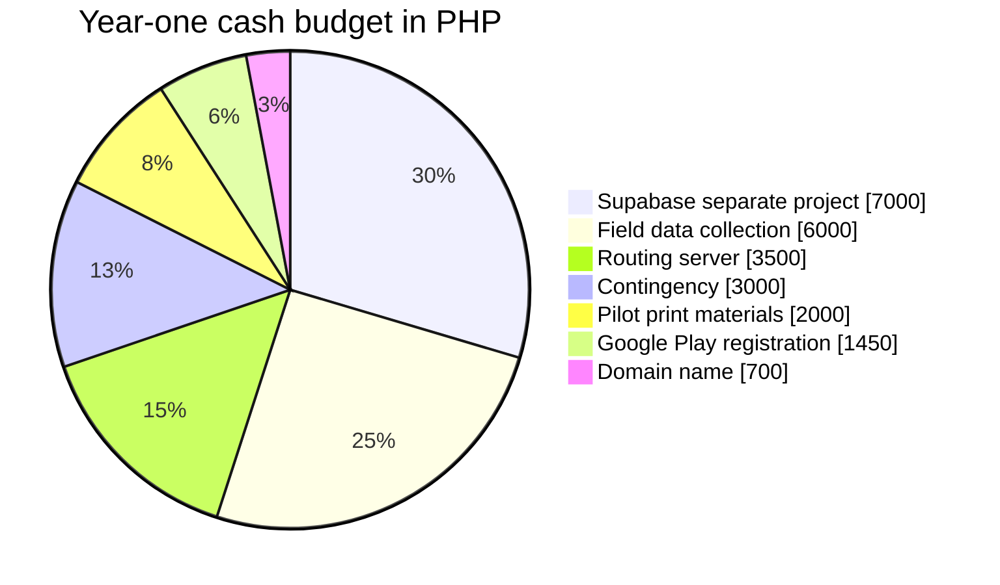

| Item | ₱ | Required? |
|---|---|---|
| Supabase second project ($10/month) | 7,000 | No. Moving the tables into the existing Supabase project costs ₱0 |
| Field data collection (fares, transport) | 6,000 | Yes |
| Routing server for OSRM ($5/month) | 3,500 | Before public launch only |
| Contingency | 3,000 | Recommended |
| Printed QR posters for partner hostels | 2,000 | For the open pilot |
| Google Play developer registration ($25, one time) | 1,450 | For Android |
| Domain name | 700 | Optional |
| **Total** | **23,650** | Minimum required: about ₱7,450 |

**Revenue.** Year one is a pilot and is expected to earn nothing. From year
two the main model is a commission on tours booked through the app. Using an
assumed average commission of ₱225 per booking (10–15% of a ₱1,500–₱2,500
island-hopping package, to be confirmed in operator interviews):

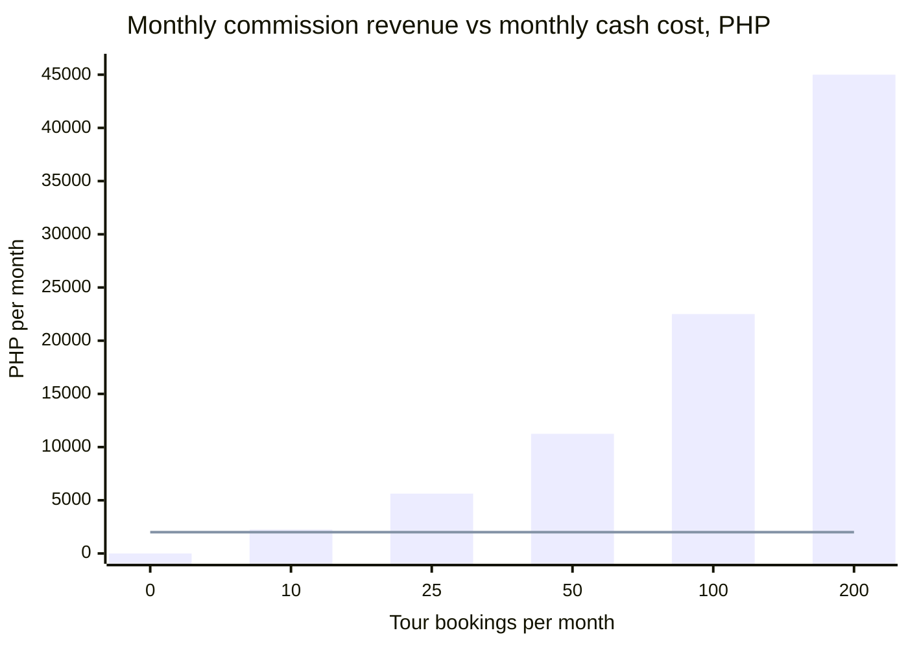

The bars are revenue; the line is the roughly ₱2,000 monthly cash cost. Cash
break-even is about **9 bookings a month**. That is easy on paper; the hard
part is earning the traffic that produces bookings.

| Year-two scenario | Bookings per month | Featured listings | Monthly revenue |
|---|---|---|---|
| Pessimistic | 10 | 0 | ₱2,250 |
| Base | 50 | 5 at ₱1,000 | ₱16,250 |
| Optimistic | 150 | 15 at ₱1,000 | ₱48,750 |

A tourism grant or LGU partnership would be separate, one-time money and is a
realistic earlier source than bookings.

### 4.6 Legal and compliance

| Item | Requirement | Status and action |
|---|---|---|
| Data Privacy Act of 2012 (RA 10173) | A privacy notice, a lawful basis and minimal collection | No accounts, location is never stored. **Publish a privacy notice before the pilot.** |
| NPC registration | Required only above set thresholds | Likely not required at pilot scale; confirm against current NPC guidance |
| OpenStreetMap data (ODbL) | Attribution | Done: "© OpenStreetMap" shown on the map |
| OSM tile usage policy | No heavy use of OSM's own tile servers | Fine for the pilot; move to a provider before scale |
| Fares | Set by LTFRB | Label fares as estimates, show the date verified, link the posted matrix |
| Google Play | Privacy policy URL, Data safety form, closed testing | New personal accounts need 12+ testers for 14 continuous days before production |
| Community posts | Rules and takedown | Publish terms of use; add a report button before public launch |
| Earning commissions | Business registration and tax | Register with DTI and BIR before collecting any revenue |

---

## 5. Pilot testing plan

### 5.1 Objectives

1. Confirm the problem is real (H1).
2. Confirm the guide is accurate and useful (H2).
3. Measure whether people come back (H3).
4. Get a yes or no from tour operators and the city (H4, H5).
5. Satisfy Google Play's closed-testing rule along the way.

### 5.2 Phases

| Phase | Dates | Goal | Output |
|---|---|---|---|
| Prep | Oct 5–9, 2026 | Update fares to the September 2026 matrix | Correct fare data |
| 0 · Validate | Oct 12–25 | Interviews: travelers, operators, tourism office | Gate 0 decision |
| 1 · Readiness | Oct 26–Nov 22 | Field-verify data, add analytics, privacy notice, Android build | App ready for testers |
| 2 · Closed pilot | Nov 23–Dec 13 | 20–30 invited testers, moderated tasks, surveys | Gate 1 decision |
| 3 · Open pilot | Jan 11–31, 2027 | Public pilot around Dinagyang (January 24) | Real-world usage data |
| Review | Feb 1–14, 2027 | Analyze results | Gate 2 decision |

### 5.3 Timeline

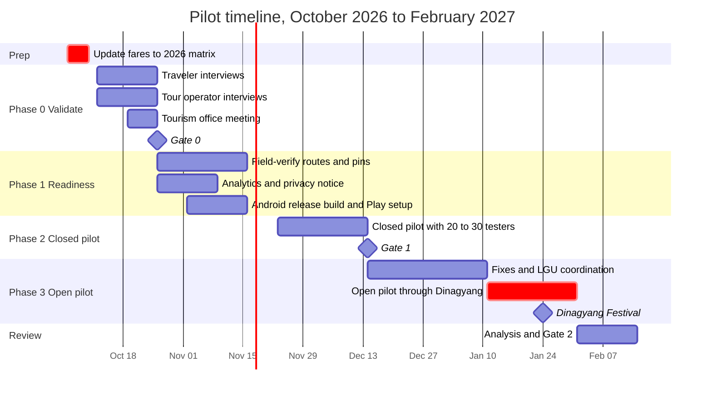

### 5.4 Participants

| Group | Closed pilot | How to recruit |
|---|---|---|
| First-time visitors | 8–10 | Hostels and guesthouses in City Proper, Iloilo travel Facebook groups |
| Locals and students | 8–10 | University organizations (UP Visayas, WVSU, CPU, USA) |
| Balikbayans and regional visitors | 4–6 | Personal networks, community groups |
| **Total** | **20–30** | At least 12 must stay opted in to the Play closed test for 14 days |

Testers must be 18 or older and sign a short consent form (Appendix A).

### 5.5 Test scenarios

Run in person, moderated, with think-aloud. Record task success and a
one-question ease rating after each task.

| # | Task given to the tester | Success means |
|---|---|---|
| T1 | "You are at the City Proper plaza. Find out how to get to Molo Mansion and what it costs." | Names the correct jeep sign and fare within 2 minutes, unaided |
| T2 | "Plan a half day with three places. What is your total jeep fare?" | Builds a plan and reads the total |
| T3 | "You are at Jaro Cathedral. Stamp it in your passport." | Check-in succeeds on site |
| T4 | "Where should you eat batchoy, and what should you order?" | Finds the Food entry and the must-try item |
| T5 | "Share a tip with a photo." | Post appears in the feed |
| T6 | "Turn on airplane mode. Can you still see how to get to Molo?" | Fare guide still visible offline |

### 5.6 Success criteria

| Metric | Target | Measured by | Phase |
|---|---|---|---|
| Route and fare accuracy | 90% or more of audited routes correct | Field audit | 1, 2 |
| T1 unaided success | 80% or more | Moderated test | 2 |
| System Usability Scale | 68 or higher (industry average) | Survey | 2 |
| Rated helpful | 70% or more | Survey | 2, 3 |
| Activation | 40% or more of first sessions use directions or the planner | Analytics | 2, 3 |
| 7-day return | 20% or more | Analytics | 2, 3 |
| Map renders | 95% or more of directions opens | Analytics | 2, 3 |
| Crash-free sessions | 99% or more | Error reports | 2, 3 |
| Operator interest | At least 2 of 3 | Interviews | 0 |
| City interest | One follow-up meeting | Meeting | 0 |

### 5.7 Analytics events

Anonymous: device ID only, never precise location or personal data. Stored in
an insert-only Supabase table, so no new vendor and no new cost.

| Event | Sent when | Properties |
|---|---|---|
| `app_open` | App starts | first_launch |
| `landing_cta` | A landing button is tapped | plan or explore |
| `tab_view` | A tab is opened | tab |
| `directions_open` | Directions sheet opens | place_id |
| `location_result` | Location lookup finishes | ok, denied, off, unavailable |
| `route_drawn` | Road route appears | km band |
| `checkin_result` | Check-in attempted | stamped, too_far, no_location |
| `ride_logged` | "I rode this" tapped | route |
| `plan_built` | Planner builds a day | stop count, total fare |
| `post_created` | Community post sent | has_photo |
| `share` | Anything shared | passport, stamp, plan |

### 5.8 Field accuracy audit

For each route and pin: ride or visit it, record the signboard text, fare
paid, travel time, transfer points and the actual coordinates, and get a
second independent confirmation. A route passes when both checks agree with
the app. See the workflow in [7.2](#72-verification-workflow).

### 5.9 Target tester journey

The scores are hypotheses (1 = frustrating, 5 = delightful). The pilot
measures them.

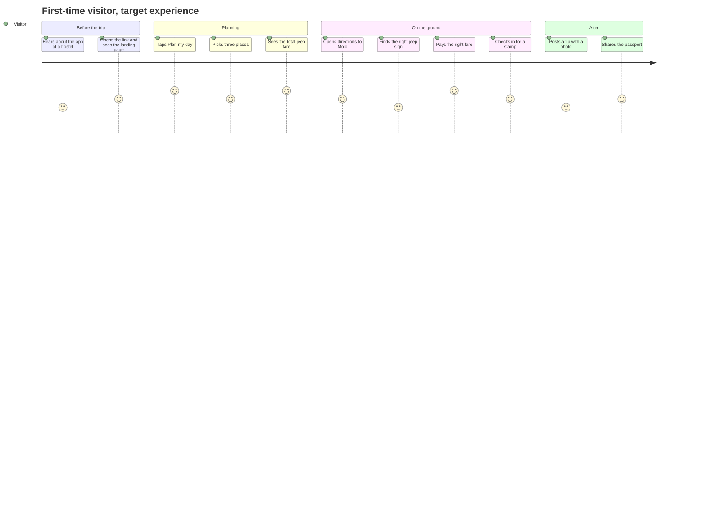

---

## 6. Deployment readiness

### 6.1 Environments and release path

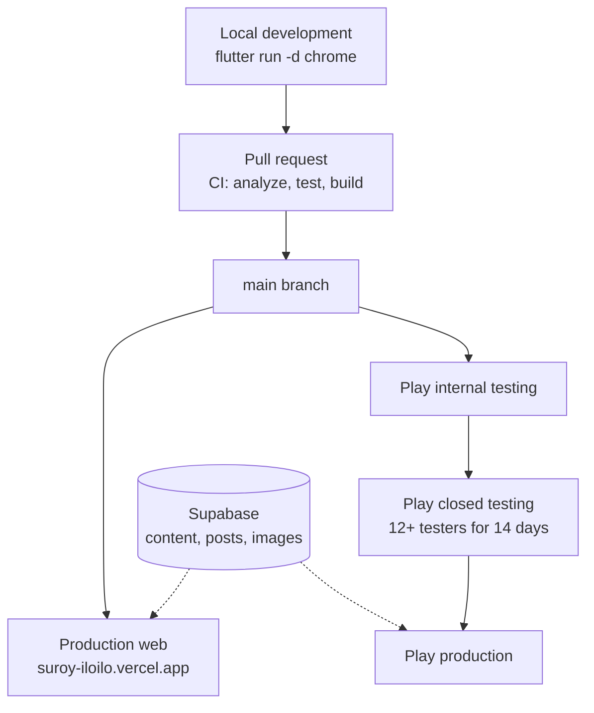

### 6.2 Readiness checklist

**Before the closed pilot**

- [ ] Update every fare to the September 28, 2026 LTFRB adjustment (₱14 traditional minimum)
- [ ] Field-verify the 8 place pins and 6 routes
- [ ] Merge `feature/hardening` into `main` and delete stale branches
- [ ] Run `schema.sql`, `seed.sql`, `community.sql` and `geo.sql`; confirm RLS on every table
- [ ] Add the analytics events table and instrument the events in 5.7
- [ ] Publish a privacy notice and a tester consent form
- [ ] Commit the `android/` folder with location permissions, app ID and icon
- [ ] Signed Android release build on the Play internal track

**Before the open pilot**

- [ ] Gate 1 criteria met
- [ ] Top issues from the closed pilot fixed
- [ ] Error reporting in place (free tier or a Supabase errors table)
- [ ] Daily moderation routine
- [ ] QR posters placed with partner hostels
- [ ] Coordination with the City Tourism Office for Dinagyang

**Before public launch**

- [ ] Routing moved off the OSRM demo server
- [ ] Map tile provider chosen
- [ ] Terms of use, takedown process, report button and `approved` flag on posts
- [ ] Play production access granted
- [ ] DTI and BIR registration before any commission revenue
- [ ] Supabase backups confirmed

### 6.3 Monitoring during pilots

| Watch | Signal of trouble | Response |
|---|---|---|
| Error reports | New crash type | Fix within 48 hours during pilots |
| `location_result` mix | More than 30% "unavailable" | Check permission prompts and timeouts |
| `route_drawn` vs `directions_open` | Fewer than 80% of opens draw a route | Check OSRM availability |
| Community posts | Spam or abuse | Delete in the Table editor; tighten rules |
| User fare reports | Any reported fare mismatch | Re-verify that route within a week |

---

## 7. Data plan

### 7.1 Data inventory

| Dataset | Source | Owner | Refresh | Freshness rule |
|---|---|---|---|---|
| Places and coordinates | Field visits | Data lead | Quarterly | Pin within 50 m of the entrance |
| Jeepney routes and steps | Riding the routes | Field verifiers | Quarterly, and after any LTFRB order | Two independent confirmations |
| Fares | LTFRB fare matrix plus field check | Data lead | Every LTFRB order | Date-stamped in the app |
| Food spots | Visits and reviews | Data lead | Twice a year | Open and serving |
| Events | City Tourism Office | Data lead | Monthly | Dates confirmed by the organizer |
| Community posts | Users | Moderator | Continuous | Reviewed daily during pilots |

**Recommended schema change:** add `verified_on` (date) and `verified_by`
(text) columns to `places` and `routes`, so the app can show "fare checked
October 2026" and stale rows are easy to find.

### 7.2 Verification workflow

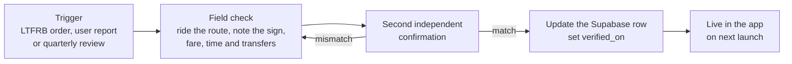

### 7.3 Field collection form

One row per route checked:

| Field | Example |
|---|---|
| Route | City Proper Plaza to Molo Church |
| Signboard text | Molo / Villa |
| Jeep type | Traditional or modern |
| Fare paid | ₱14 |
| Travel time | 18 minutes |
| Boarding point | Plaza Libertad side |
| Drop-off point | In front of Molo Church |
| Transfers | None |
| Checked by and date | Initials, 2026-10-28 |
| Notes | Rush hour, full jeeps after 5 PM |

---

## 8. Metrics and KPIs

**North star: guided trips per week** — the number of times someone opened
directions or built a plan. It measures the one thing the app exists to do.

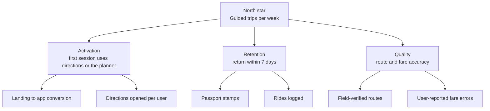

**Pilot funnel targets** (closed and open pilot combined)

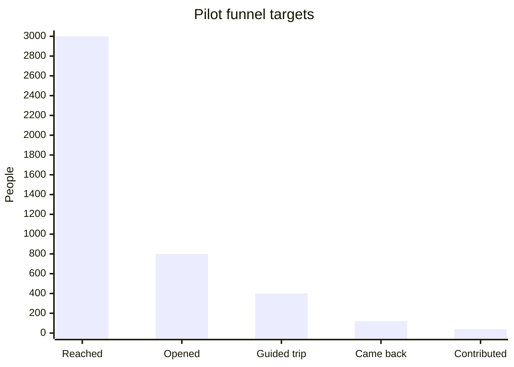

*Guided trip* = opened directions or built a plan. *Came back* = returned
within 7 days. *Contributed* = checked in, posted a tip or logged a ride.

---

## 9. Risk register

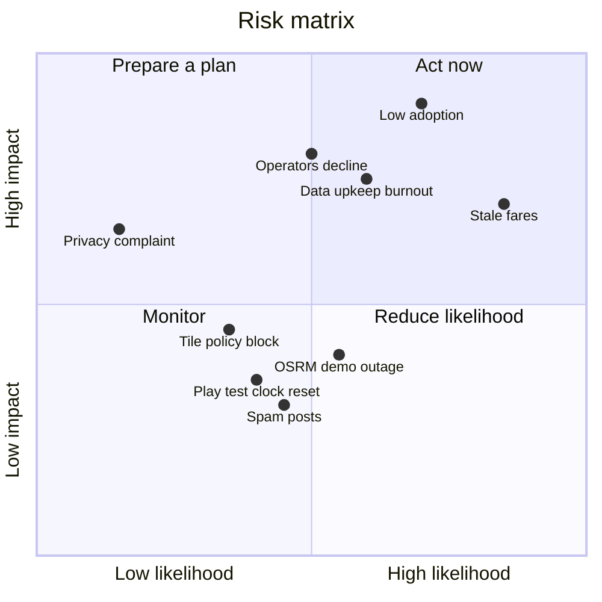

| Risk | Likelihood | Impact | Mitigation | Owner |
|---|---|---|---|---|
| Low adoption | High | High | Validate in Phase 0; launch on Dinagyang; partner with hostels and the city | Founder |
| Stale fares | High (already happened) | High | Date-stamp fares; re-check after every LTFRB order; user "wrong fare" reports | Data lead |
| Data upkeep burnout | Medium | High | Volunteer verifiers; quarterly schedule; keep coverage focused | Founder |
| Operators decline commissions | Medium | High | Offer free listings first; grant and LGU path as fallback | Founder |
| OSRM demo outage | Medium | Medium | App already degrades to pins; self-host before launch | Developer |
| OSM tile policy block | Low | Medium | Switch to a tile provider before scale | Developer |
| Spam in community posts | Medium | Low | Daily moderation; report button and approval flag | Moderator |
| Privacy complaint | Low | Medium | Privacy notice; no stored location; data minimization | Founder |
| Play closed-test clock resets | Medium | Low | Recruit 20 or more so drop-outs stay above 12 | Founder |

---

## 10. Roadmap and milestones

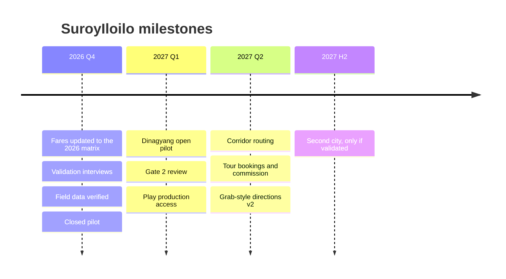

| Milestone | Target date | Done when |
|---|---|---|
| Fares corrected | October 9, 2026 | All fares match the September 2026 matrix |
| Gate 0 | October 26, 2026 | H1 decided from interviews |
| Ready for testers | November 22, 2026 | Section 6.2 closed-pilot list complete |
| Gate 1 | December 14, 2026 | Closed-pilot criteria reviewed |
| Dinagyang | January 24, 2027 | Open pilot live during the festival |
| Gate 2 | February 14, 2027 | Scale, civic path or shelve decided |

---

## 11. Immediate next actions

1. **Fix fares.** Update seed data and Supabase to the September 28, 2026
   adjustment. Do not guess per-route fares; recompute from the posted matrix
   and verify in the field.
2. **Merge and clean up.** Merge `feature/hardening` (and this branch) into
   `main`; delete stale feature branches.
3. **Schedule Phase 0.** Book 5–10 traveler interviews, 2–3 operator
   interviews and one tourism office meeting for October 12–25.
4. **Prepare the instruments.** Print the consent form and SUS survey
   (Appendix A).
5. **Decide the Supabase project.** Keep the separate project (₱7,000 a year)
   or move the tables into the existing project (₱0).

---

## Appendix A — Test instruments

**Interview scripts** for travelers, tour operators and the tourism office are
in the business proposal (section 06). Run them before Phase 1.

**Consent form (summary)**

- Purpose: testing a travel app for Iloilo City.
- What we collect: your answers, task timings, and anonymous app events.
- What we do not collect: your name in the data, your precise location, or
  anything from your phone outside the app.
- You can stop at any time. You must be 18 or older.

**Single Ease Question** (after each task): "Overall, how easy or difficult
was this task?" from 1 (very difficult) to 7 (very easy).

**System Usability Scale** (after the session; 1 = strongly disagree,
5 = strongly agree):

1. I think I would like to use this app frequently.
2. I found the app unnecessarily complex.
3. I thought the app was easy to use.
4. I think I would need help from someone technical to use this app.
5. I found the various functions in this app were well integrated.
6. I thought there was too much inconsistency in this app.
7. I would imagine most people would learn to use this app very quickly.
8. I found the app very cumbersome to use.
9. I felt very confident using the app.
10. I needed to learn a lot of things before I could get going with this app.

Scoring: for odd items subtract 1 from the answer; for even items subtract
the answer from 5; add the results and multiply by 2.5. The result is 0–100,
and 68 is the usual average.

## Appendix B — Assumptions register

| Assumption | Value used | Validate by |
|---|---|---|
| Share of arrivals open to public transport | 30% | Traveler interviews |
| Year-one reach | 2% of that group | Pilot funnel data |
| Locals who would use it for commutes | 0.5% | Closed pilot, local testers |
| Island-hopping package price | ₱1,500–₱2,500 per person | Operator interviews |
| Commission rate | 10–15% | Operator interviews |
| Taxi cost used in the fare-saved counter | ₱150 per trip | Field check |
| Monthly running cost | About ₱2,000 | Actual bills |
| Exchange rate | ₱58 per USD | Update at time of purchase |

## Appendix C — Sources

- Iloilo City tourist arrivals, 2023–2024 (DOT figures as reported): [news report](https://www.mexc.com/it-IT/news/589993)
- Dinagyang 2026 attendance: [Daily Tribune](https://tribune.net.ph/2026/01/25/iloilo-tourists)
- Western Visayas arrivals target: [The Manila Times](https://manilatimes.net/2024/07/13/regions/region-6-eyes-56m-tourist-arrivals/1956942)
- March 2026 fare adjustment: [Top Gear Philippines](https://www.topgear.com.ph/news/motoring-news/ltfrb-approves-fare-adjustments-puvs-a2578-20260317)
- March 2026 suspension: [Context.ph](https://context.ph/2026/03/18/malacanang-orders-surprise-halt-on-transport-fare-hikes/)
- Suspension lifted, new fares from September 28, 2026: [Philstar](https://philstar.com/headlines/2026/09/26/2558947/dotr-lifts-suspension-puv-fare-hike), [PhilstarLife](https://philstarlife.com/news-and-views/486689-dotr-approves-puv-fare-hikes-effective-sept-28)
- Google Play closed testing requirement: [Play Console Help](https://support.google.com/googleplay/android-developer/answer/14151465?hl=en)
- OpenStreetMap tile usage policy: [OSMF](https://operations.osmfoundation.org/policies/tiles/)
- OpenStreetMap copyright and license: [openstreetmap.org/copyright](https://www.openstreetmap.org/copyright)
- OSRM demo server usage: [Project-OSRM wiki](https://github.com/Project-OSRM/osrm-backend/wiki/Demo-server)
- Data Privacy Act of 2012: [National Privacy Commission](https://privacy.gov.ph/data-privacy-act/)
- Iloilo City population: PSA 2020 Census of Population and Housing
