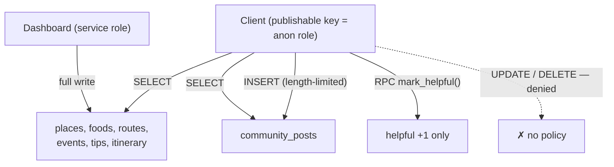

# SuroyIloilo — Security & Privacy

The app is anonymous and backend-optional, which keeps the attack surface
small. This documents the model and its deliberate limits.

## Threat model in one line

The only server-side asset is public tourism content plus anonymous community
posts. There are no user accounts, no personal identifiers, and no payment
data. The worst realistic abuse is spam or defacement of community posts,
which is contained by Row Level Security and manual moderation.

## Secrets

- Only the Supabase **publishable key** (`sb_publishable_…`) ships in the
  client. It is designed to be public and is useless without the RLS policies.
- The **service_role / secret** key is never in the app or the repo.
- `.env.local` is git-ignored; `.env.example` (placeholders) is tracked.
- No other credentials exist — maps, routing and geolocation are keyless.

## Row Level Security (Postgres)

- **Content tables:** `SELECT` allowed for everyone; no client write policy →
  inserts/updates/deletes are denied. Editing happens in the Supabase Table
  editor under the service role.
- **community_posts:** `SELECT` for everyone; `INSERT` allowed only when
  `author` is 1–40 chars and `body` is 1–1000 chars (checked in the policy).
  No `UPDATE`/`DELETE` policy → clients cannot edit or remove any post,
  including their own. Moderation = deleting rows in the dashboard.
- **Hearts:** the `helpful` counter is never writable directly; it moves only
  through the `mark_helpful(post_id)` `SECURITY DEFINER` function, which does a
  single `+1`. This prevents tampering with counts.
- **Storage (`community-images`):** public read; insert restricted to the
  bucket, capped at 5 MB, image MIME types only.

## Input handling

- Post length limits are enforced **both** client-side (nicer UX) and in the
  RLS `INSERT` policy (authoritative).
- Uploaded images are size- and type-capped by the bucket, and re-encoded /
  downscaled client-side before upload.
- Remote content is treated as text; the UI never evaluates it as code.

## Privacy

- **Location** is requested only when the user opens directions or checks in,
  used in-memory to draw a route or compute distance, and never stored or
  transmitted to our backend. On web it is the browser Geolocation API; on
  mobile, the OS — both gated by an explicit permission prompt.
- **Device id** is a random per-install string in `shared_preferences`, not a
  hardware identifier. It exists to enable future rate-limiting/moderation and
  to prevent double-hearting; it is not linked to any identity.
- No analytics or third-party trackers are bundled.

## Deliberate limitations (pilot)

- **No auth.** Anonymous posting means spam is *possible*. Acceptable at pilot
  scale with dashboard moderation; the device id + a future `approved` flag are
  the upgrade path. Real accounts (Supabase Auth) arrive only when saved trips
  / personalization justify them.
- **Public OSRM demo server** is used for routing; for production it should be
  self-hosted or a paid endpoint (rate limits, uptime).
- The publishable key is world-readable by design — all protection rests on
  RLS, so **RLS must stay enabled on every table** (the schema enforces this).

## Checklist before a public launch

- [ ] Confirm RLS is enabled on every table (`schema.sql` does this)
- [ ] Add an `approved` flag + a report button for community posts
- [ ] Move routing off the OSRM demo server
- [ ] Add basic abuse rate-limiting keyed on `device_id`
- [ ] Privacy policy page (required for app stores)
