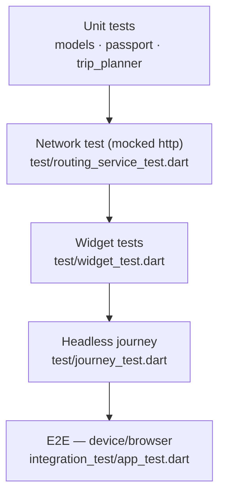

# SuroyIloilo — Testing

The suite is layered so most logic is verified fast on the Dart VM, with a
device/browser e2e for the full journey.

## Test pyramid



## What each layer covers

| Layer | File | Verifies |
|---|---|---|
| **Unit** | `test/models_test.dart` | `fromJson` for every model; `iconFromKey`, `PlaceCategoryX.fromKey`, `signboardOf` |
| **Unit** | `test/passport_logic_test.dart` | `fareSaved` math (clamping), badge rules, check-in messages |
| **Unit** | `test/trip_planner_test.dart` | itinerary ordering, far-trip flagging, timing, fare totals, `formatMinutes` |
| **Network** | `test/routing_service_test.dart` | OSRM URL building, geojson parsing, 200 / non-200 / exception / empty via a mocked `http.Client` |
| **Widget** | `test/widget_test.dart` | boot, tab navigation, landing→planner, plan building, passport open |
| **Journey (headless)** | `test/journey_test.dart` | full flow landing → explore → every tab → passport; returning-user skip |
| **E2E (device)** | `integration_test/app_test.dart` | same journey on a real device/browser |

## Running

```bash
# Everything that runs on the VM (unit + network + widget + headless journey)
flutter test

# Static analysis
flutter analyze

# Build verification (compiles the web target end-to-end)
flutter build web --release

# Device / browser e2e (needs an emulator, device, or chromedriver)
flutter test integration_test/app_test.dart            # on a connected device
flutter test integration_test/app_test.dart -d chrome  # needs chromedriver
```

## Notes

- `flutter test` runs 30+ checks headlessly in a few seconds — no device
  needed. This is the gate for every commit.
- `test/journey_test.dart` is a VM-runnable mirror of the device e2e, so the
  full journey is verified in CI even without a device.
- Repositories that touch `shared_preferences` use
  `SharedPreferences.setMockInitialValues({})` in `setUp`.
- Network code is isolated in `RoutingService` specifically so it can be tested
  with `package:http/testing.dart`'s `MockClient` — no real requests are made.
- Supabase is not mocked; content-repository behavior is covered indirectly by
  the offline-fallback path (unconfigured → seed), which the widget tests
  exercise.

## CI suggestion

```yaml
# .github/workflows/ci.yml (sketch)
- run: flutter pub get
- run: flutter analyze
- run: flutter test
- run: flutter build web --release
```
